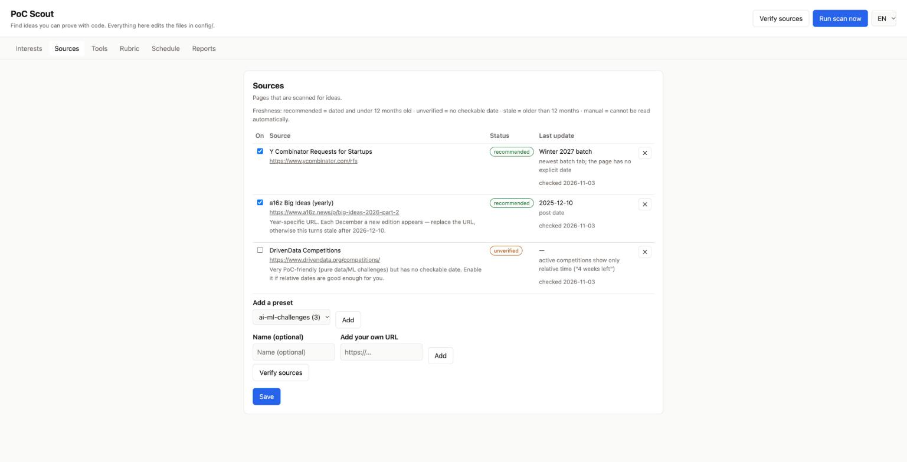
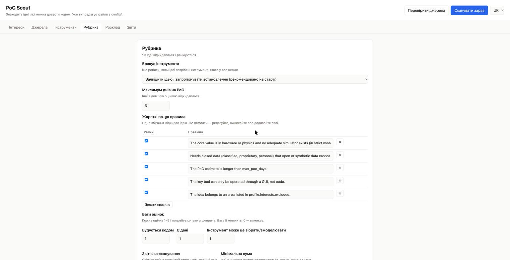

# PoC Scout

Once a month (or week), PoC Scout reads the "requests for startups", challenge lists and innovation calls you choose, keeps only ideas you could **prove with code** in a few days, and writes a one-page report for each. When one looks good, `/poc-build` turns it into a plan and starts the work — after you confirm.

It runs locally on top of [Claude Code](https://docs.claude.com/en/docs/claude-code). No cloud services besides Claude, no telemetry.

```
sources ─► scanner ─► judge ─► reporter ─► reports/<date>/OVERVIEW.md + one page per idea
           (reads)    (no-go rules,        (summary, stack, what's missing,
                      quoted scores)        scope, first 1–2 h step)
```

## Quickstart

```bash
git clone https://github.com/dmytroborbotko-pets/poc_scout.git
cd poc_scout
./setup.sh
```

Requirements: macOS or Linux (Windows: [WSL](docs/windows-wsl.md)), [Node.js 20+](https://nodejs.org), Claude Code installed and logged in.

`./setup.sh` walks you through a one-time step: letting Claude Code work in this folder (its "trust this folder" prompt).

Example output: [one report from a real test scan](docs/example-report.md).

## Three ways to set it up — one config

`./setup.sh` asks how you want to start:

| | Technical | Technical but quick | Non-technical |
|---|---|---|---|
| You use | files, agents, commands | Claude asks you questions | a page in your browser |
| Setup questions | all of them | only what's needed to start | a 7-step wizard in the browser (skip it any time) |
| Finds and checks sources for you | — | yes | via "Verify sources" |

All three edit the **same files in `config/`**, validated against `schema/`. Switch any time: open the UI with `npm run ui`, run `claude "/poc-setup"`, or edit the YAML by hand — comments and extra fields you add are kept by every mode. See [docs/modes.md](docs/modes.md).

| Sources with freshness checks | Rubric (Ukrainian UI) |
|---|---|
|  |  |

## Commands (inside `claude` in this folder)

| Command | What it does |
|---|---|
| `/poc-setup` | guided setup: interests, rules, sources (searches and verifies them), schedule |
| `/poc-scan [max_sources=N] [top_n=N]` | scan → judge → reports |
| `/poc-verify-sources [url …]` | check each source's latest date and readability |
| `/poc-tools` | review tools recent ideas need; install only what you approve |
| `/poc-build reports/<date>/<idea>.md` | plan the PoC, ask you, then build in `builds/<idea>/` |

## How ideas are judged

- **Hard no-go rules** — five defaults (hardware without a simulator, closed data, too long, GUI-only tool, excluded area). Keep, edit, switch off or add your own.
- **Scores 1–5** — buildable with code, data available, a tool can build/simulate it. Each needs a quote from the source, otherwise it counts as 1. Weights are yours.
- **Missing tools** — by default ideas are kept and the tools they need are listed (`runs/<date>-tools-suggested.md`); `/poc-tools` installs what you approve. Switch to `strict` to reject instead.
- **Your own scores** — add axes like "fits my job search"; choose whether they count toward selection.
- **Dedup** — every processed idea is remembered in `state/seen.json`; repeat scans only report new ones.

## Scheduling

```bash
scripts/schedule.sh install    # launchd (macOS) / systemd user timer or cron (Linux)
scripts/schedule.sh status     # also checks the scheduler can see your Claude login
scripts/schedule.sh uninstall
```

Details and the known login caveat: [docs/scheduling.md](docs/scheduling.md).

## Safety

Scans run headless with `--permission-mode dontAsk`, a minimal `--allowedTools` list (web fetch, files inside this folder, two helper scripts) and a budget cap — never `--dangerously-skip-permissions`. Web content is treated as data, not instructions. See [SECURITY.md](SECURITY.md).

## More

[Configuration reference](docs/configuration.md) · [Technical guide](docs/technical.md) · [Troubleshooting](docs/troubleshooting.md) · [Contributing](CONTRIBUTING.md) · [Changelog](CHANGELOG.md)

MIT licensed.
